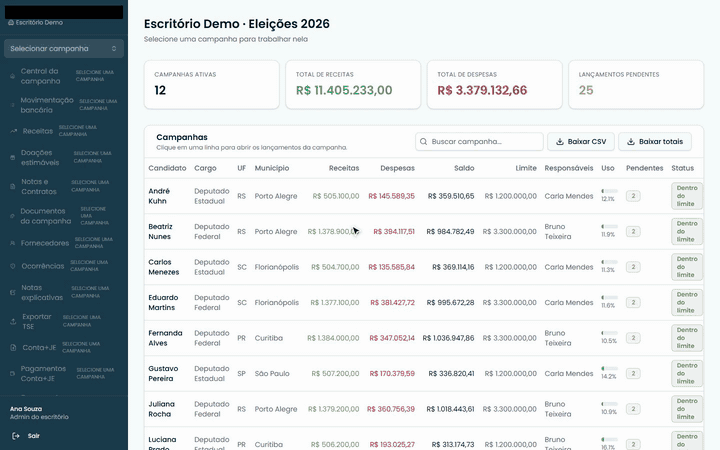

# Rafael Cardona

TI na Giacomoni Contabilidade, Porto Alegre/RS, e estudo Análise e
Desenvolvimento de Sistemas na FIAP. Utilizo IA para construir e manter os sistemas que a equipe usa no dia a dia. 
Defino regras, casos de uso, construo e coloco os sistemas no ar.

Há um ano, quando comecei, eu ainda escrevia algum código, e quando usava IA, testava tudo à mão, porque elas eram menos capazes do que hoje. Hoje a
maioria dos agentes roda os testes sozinha e me manda a prova de que passou. Eu
confiro antes de publicar.

Construí um sistema de prestação de contas de campanhas que o
escritório usou nas Eleições 2026. A gravação usa dados mockados.
[Como ele foi feito](casos/prestacao-de-contas.md)

## Como eu trabalho

Meus agentes rodam numa VPS que fica ligada o tempo todo. Utilizo o Hermes Agent, Claude Code, Codex e Antigravity.

Cada projeto tem um catálogo de contexto com as regras de negócio, as decisões
já tomadas e como testar cada parte. O agente lê isso antes de mexer, então eu
não preciso explicar tudo de novo a cada pedido.

Quando termina, o agente roda os testes, abre o sistema num Chromium headless
e me manda prints ou um vídeo curto do fluxo funcionando.

Eu confiro a prova e o código e publico.

## Na Giacomoni Contabilidade

Código privado. Em cada página eu explico qual era o
problema, o que eu construí e os números de uso, sem nenhum dado de cliente.

| Projeto | O que é | Resultado |
| --- | --- | --- |
| [Prestação de contas](casos/prestacao-de-contas.md) | Sistema de prestação de contas de campanhas eleitorais, com uma extensão para o Chrome que lança tudo no sistema do TSE, pois ele não aceita importação, apenas lançamento manual. | Mais de 150 campanhas nas Eleições 2026, milhares de lançamentos e registros enviados ao TSE, sem ninguém digitar nada à mão. |
| [APIs de automação](casos/apis-de-automacao.md) | 17 APIs que transformam relatório de folha (RPA), extrato bancário, balancete e fatura no arquivo de importação da Domínio, do SPCA e do TSE | Um lote de 10 documentos levava cerca de 1 hora. Agora é 1 envio e cerca de 15 segundos de processamento |
| [Controle Fiscal](casos/controle-fiscal.md) | Acompanhamento mensal do Fator R das empresas do Simples Nacional | Usado todo mês pelos setores Pessoal e Fiscal para fechar o Fator R de cada empresa |
| Portal Interno | Clientes, tarefas, procedimentos e automações da equipe num lugar só | A equipe toda usa no dia a dia desde fevereiro de 2026 |

## Projetos meus

- **[Sturnix](https://sturnix.run)** é uma fila de tarefas para agentes de código.
  Alguém descreve o ajuste ou pedido no dashboard, o agente implementa e abre o pull request, e uma
  pessoa revisa. Fiz uma CLI própria, publicada no npm, e as instruções são
  assinadas (Ed25519), então o agente só executa o que veio de quem tem
  permissão. Do primeiro commit até a CLI sair no npm foram 11 dias.
  Antes, os pedidos de ajustes ou melhorias nos sistemas da equipe chegavam toda hora. A cada um eu parava o que estava fazendo, resolvia ou passava para a IA. Com o Sturnix, quem precisa de algo pode registrar diretamente no dashboard (muito simples de usar), e de tempos em tempos eu mandava para o agente buscar as tarefas e realizá-las (após eu ver o que seria feito). Meu trabalho era apenas revisar antes de publicar.
- No **[Chatdock SDK](https://github.com/rSaintH/chatdock_sdk)**, peguei o Vercel
  AI SDK e adaptei para o que a empresa precisava, num pacote que pluga
  chatbots com tool calling nos nossos sistemas em React/Next.js. Usei em 3 sistemas internos. Antes de qualquer ação sensível, uma pessoa precisa aprovar. Está
  no npm como `@rsainth/chatdock-sdk`.
- **[AniDraft](https://anidraft.com.br)** é um jogo web publicado, com torneios,
  rankings e perfis. Fiz em agosto de 2026 quando os jogos de draft no navegador estavam na moda.

## Contato

[LinkedIn](https://linkedin.com/in/cardonarafael) · rcardonash@gmail.com
