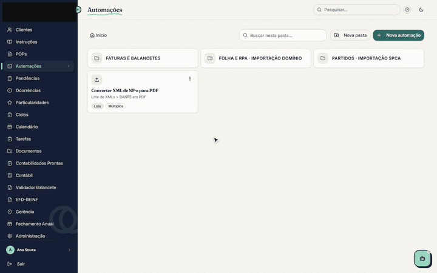

# APIs de automação: folha, Domínio e SPCA

São 17 APIs em Python (FastAPI) que pegam o que chega dos clientes (relatório
de folha, extrato bancário, PDF de fatura, balancete) e devolvem o arquivo
pronto para importar no sistema de destino: Domínio, SPCA ou o sistema do TSE.
Fazem parte da rotina da equipe da Giacomoni Contabilidade.

O código é privado, porque é da empresa. Nenhum documento de cliente aparece
aqui.

No Portal Interno, a pessoa escolhe a automação, solta todos os arquivos de uma vez e
recebe o arquivo no layout de importação. A gravação usa documentos e nomes
fictícios.
[Vídeo em resolução maior](../assets/portal-interno-demo.mp4)

## O problema

Tudo isso chegava em PDF ou extrato, e alguém abria documento por documento e
digitava no sistema. No ritmo normal, **uns 10 documentos levavam uma hora.** E
como a mesma rotina se repete todo mês, em várias empresas, o tempo perdido
também se repetia.

## O que elas cobrem

- **Folha e RPA:** o relatório de RPA da Domínio vira o arquivo de importação,
  tanto para a Domínio quanto para o SPCA.
- **Prestação de contas de partidos no SPCA:** contribuições, doações, Fundo
  Partidário, repasses e aplicação de recursos, a partir do extrato bancário ou
  de planilha.
- **Contabilidade:** balancetes em PDF viram CSV, e relatórios de outros
  sistemas viram o TXT contábil.
- **Faturas:** faturas em PDF viram CSV.
- **Utilitários:** conversão de XML para PDF.

## Como roda

- Cada API é um serviço separado no Render, então uma fora do ar não derruba
  as outras.
- O Portal Interno guarda o cadastro de cada automação (nome, URL e
  parâmetros), organizado em pastas por cliente, e registra quem usou e quando.
- Os leitores de PDF mais críticos têm testes automatizados.

## Resultado

| | Antes | Depois |
| --- | --- | --- |
| 10 documentos | cerca de 1 hora de digitação | 1 envio + cerca de 1 minuto de processamento |
| 50 documentos | cerca de 5 horas | 1 envio + cerca de 1 minuto de processamento |

O tempo que sobrou é o processamento da API, perto de 1 minuto por lote. Daria
para baixar isso reescrevendo numa linguagem mais rápida, mas com o volume atual
do escritório o ganho não compensa o trabalho.

**Stack:** Python, FastAPI, pdfplumber, Google Sheets e Apps Script, Render.
