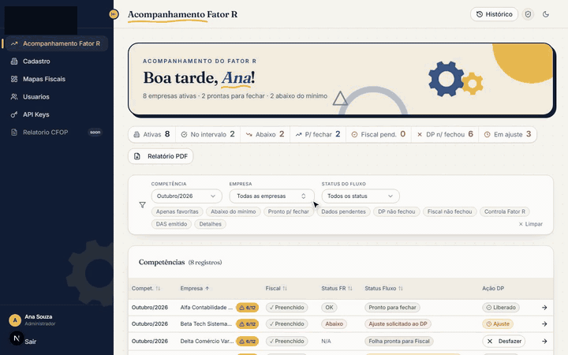

# Controle Fiscal

Sistema interno da Giacomoni Contabilidade para acompanhar, mês a mês, o Fator R
das empresas do Simples Nacional.

Código privado. O vídeo abaixo é o sistema real em modo
de demonstração, com empresas e valores fictícios.

[Vídeo em resolução maior](../assets/controle-fiscal-demo.mp4)

## O problema

No Simples Nacional, uma empresa de serviço paga bem menos imposto se a folha de
pagamento dos últimos 12 meses for pelo menos 28% do faturamento (é isso que se
chama de Fator R). Se num mês ela fica abaixo disso, a alíquota sobe. Para
acompanhar isso em dezenas de empresas, todo mês, é preciso juntar os dados do
Departamento Pessoal e do Fiscal a tempo de corrigir a folha antes do
fechamento.

## O que eu construí

- **Acompanhamento mensal de cada empresa.** O sistema mostra faturamento,
  folha, INSS e DAS de cada competência, com o Fator R acumulado de 12 meses e o status de cada uma
  (no intervalo, abaixo ou acima).
- **Quanto falta.** Quando a empresa fica abaixo do mínimo, o sistema calcula
  quanto precisa entrar na folha para voltar aos 28%. O Fiscal pede o ajuste ao
  DP pelo próprio sistema.
- **Fluxo DP → Fiscal → Fechamento,** com o histórico de quem fechou, quem pediu
  ajuste e quem reabriu cada competência.
- **Mapas fiscais** com a evolução do faturamento, da folha e da alíquota
  efetiva, que dá para exportar em PDF e mandar ao cliente.
- **Integração com o Portal Interno,** que recebe o status fiscal de cada
  empresa sem ninguém redigitar nada.

## Uso

Os setores Pessoal e Fiscal usam todo mês para fechar o Fator R de cada
empresa.

## Onde entra a IA

Construí com agentes de código (Claude Code, Codex e Hermes Agent), igual aos
outros sistemas. As regras de cálculo ficam separadas e cobertas por testes,
porque é ali que um erro custa dinheiro ao cliente. Os agentes rodam esses
testes e me mandam a prova de que passou antes de eu aceitar a mudança.

Feito com Next.js, TypeScript e Supabase, e testado com Vitest e Playwright.
