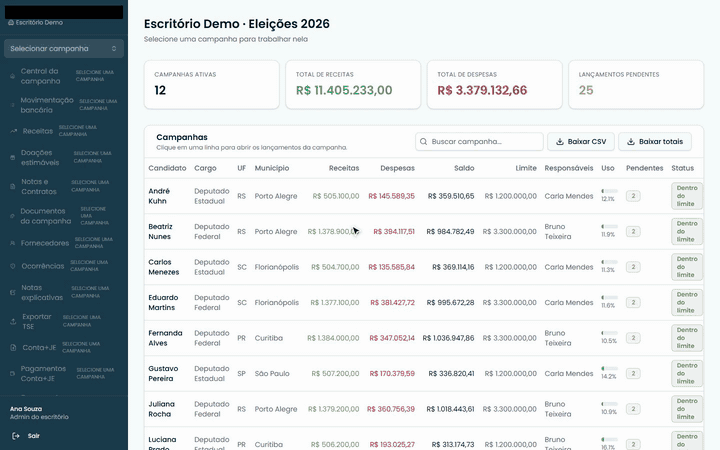
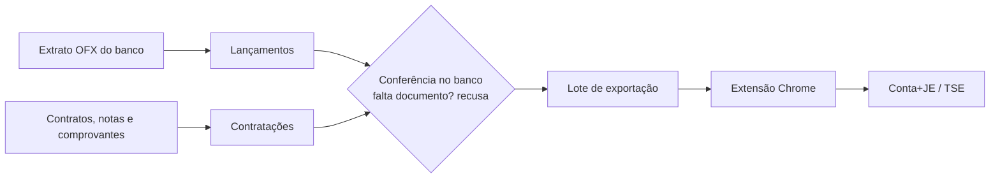

# Prestação de contas

Sistema de prestação de contas de campanhas eleitorais que a equipe da
Giacomoni Contabilidade usou nas Eleições Gerais de 2026.

O código é privado, porque é da empresa. Aqui eu explico o que construí e mostro
os números de uso. Nenhum dado de cliente aparece
nesta página, apesar dos dados das prestações serem públicos.

A gravação é o sistema de verdade com dados mockados. Aparecem a lista de
campanhas, a movimentação bancária importada do extrato e um lote pronto para
enviar ao Conta+JE.
[Vídeo em resolução maior](../assets/prestacao-de-contas-demo.mp4)

## O problema

Todo candidato precisa prestar contas à Justiça Eleitoral de tudo que entra e
sai da campanha: doações, contratos e pagamentos, cada um com o seu documento.
O escritório atendia mais de cem campanhas ao mesmo tempo, e cada doação
recebida tinha que ser declarada em até 72 horas.

O sistema do TSE para isso, o Conta+JE, não importa arquivo nenhum. Cada
lançamento é digitado à mão, tela por tela. Com milhares de lançamentos, isso
vira dias de digitação com margem para erro de transcrição.

## O que eu construí

O sistema começou como um protótipo feito no Lovable. Eu
peguei o projeto, refiz e comecei a expandir conforme as necessidades da empresa.

- **O sistema web.** Importa o extrato bancário (OFX) de cada conta de campanha,
  transforma cada transação em lançamento e liga o pagamento à contratação e aos
  documentos (contrato, nota fiscal, comprovante).
- **Conferência no banco de dados.** As regras da prestação de contas ficam em
  gatilhos no Postgres: se falta o documento exigido, o lançamento é recusado e
  a mensagem diz o que falta.
- **Uma extensão do Chrome** que lança no Conta+JE o que o sistema exporta. Ela
  preenche os campos e clica em Salvar, igual uma pessoa faria. É mais lento do
  que usar uma API, mas muito mais rápido do que digitar à mão. A extensão não
  consegue gravar nada que o próprio Conta+JE recusaria.
- **Prazos e acompanhamento:** relatórios de 72 horas, ocorrências por campanha,
  trilha de auditoria de cada alteração e três perfis de acesso (administrador,
  coordenador e contador).

## Números

Base de produção das Eleições Gerais 2026, levantados em 10/11/2026 (sem contar
registros excluídos nem a campanha de teste):

| | |
| --- | --- |
| Campanhas atendidas | mais de 150 |
| Contratações registradas | mais de 4 mil |
| Lançamentos | 6.922 |
| Extratos bancários importados | mais de mil, com quase 20 mil transações lidas |
| Documentos anexados | mais de 4 mil |
| Enviados ao Conta+JE pela extensão | 5.288 registros, em 977 lotes |
| Relatórios de 72 horas entregues | 367 |

99,8% dos lançamentos vieram da importação de extrato, e não de digitação.

Num lote grande, a extensão fez em **3 horas o que levaria 3 dias de
digitação**.

## Onde entra a IA

Construí o sistema com agentes de código (Claude Code, Codex e Hermes Agent)
trabalhando direto no repositório. Para eles não repetirem erro que já foi
resolvido, mantenho uma pasta de documentação escrita para os agentes com as
regras do projeto, erros já cometidos e o que já foi testado de fato no Conta+JE.

No começo eu testava tudo à mão. Hoje os agentes rodam os testes e me mandam a
prova de que passou, e eu confiro. Menos a extensão, pois ela mexe em um sistema muito crítico.

A IA escreve boa parte do código. Quem modelou as regras eleitorais, decidiu
operar a tela em vez de usar uma API e validou tudo com a equipe fui eu.

**Stack:** React, TypeScript, TanStack Router, Supabase (Postgres, RLS, gatilhos,
Edge Functions) e extensão do Chrome (Manifest V3).
